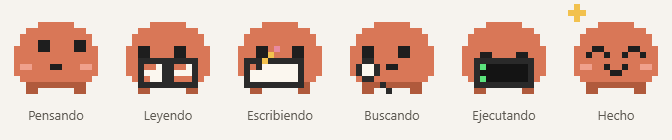
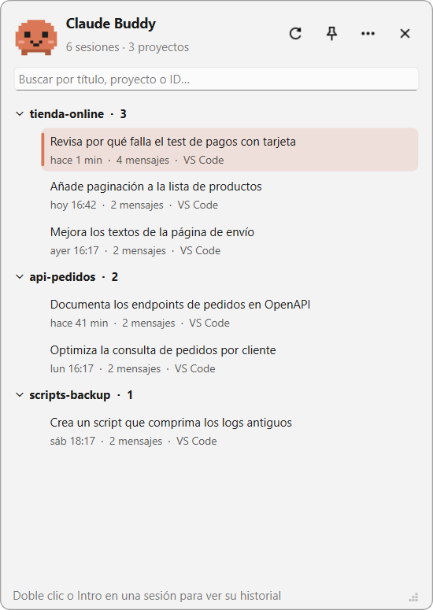
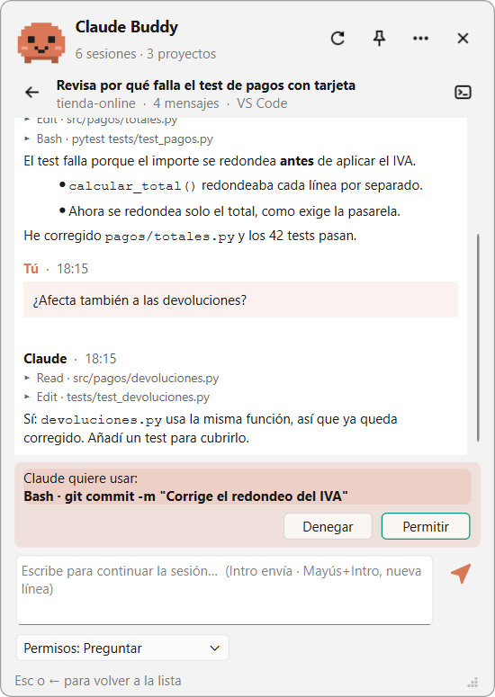

<p align="center"><a href="README.md">English</a> · <b>Español</b></p>

<p align="center">
  
</p>

<h1 align="center">Claude Buddy</h1>

<p align="center">
  <b>Una mascota de escritorio para todas tus sesiones de Claude Code.</b><br>
  Búscalas, lee su historial, sigue chateando con ellas o ábrelas en la terminal,<br>
  mientras un pequeño compañero pixel-art te cuenta qué está haciendo Claude.
</p>

<p align="center">
  <a href="https://github.com/Electrobridges/claude-buddy/actions/workflows/tests.yml"></a>
  
  
  
  
  
  
</p>

<p align="center">
  <a href="../../releases"><b>Descargar</b></a> ·
  <a href="#instalación">Instalación</a> ·
  <a href="#modo-mascota">Modo mascota</a> ·
  <a href="#uso">Uso</a> ·
  <a href="#privacidad">Privacidad</a> ·
  <a href="docs/formato-jsonl.md">Formato de sesiones</a>
</p>

<p align="center">
  
</p>

<table>
  <tr>
    <td width="50%"></td>
    <td width="50%"></td>
  </tr>
  <tr>
    <td align="center"><b>Todas tus sesiones</b><br><sub>CLI, VS Code y Desktop, agrupadas por proyecto y con búsqueda</sub></td>
    <td align="center"><b>Historial y chat</b><br><sub>Sigue cualquier conversación con respuesta en streaming y permisos</sub></td>
  </tr>
</table>

> Proyecto **no oficial** de la comunidad, sin relación con Anthropic. «Claude» y «Claude Code»
> son marcas de Anthropic. El personaje es un diseño propio de este proyecto.

## Características

<table>
  <tr>
    <td width="33%" valign="top">🗂️ <b>Sesiones en un sitio</b><br>Lee <code>~/.claude/projects</code>: título, proyecto, última actividad, mensajes y origen.</td>
    <td width="33%" valign="top">🔎 <b>Búsqueda</b><br>Por título, proyecto, ruta o ID, sin importar mayúsculas ni acentos.</td>
    <td width="33%" valign="top">📜 <b>Historial</b><br>Markdown, tablas, código, herramientas usadas y errores; se actualiza en directo.</td>
  </tr>
  <tr>
    <td valign="top">💬 <b>Chat</b><br>Continúa la sesión con <code>claude-agent-sdk</code>: streaming, mismo proyecto y avisos de permiso.</td>
    <td valign="top">🖥️ <b>Abrir en terminal</b><br><code>claude --resume &lt;id&gt;</code> en la carpeta del proyecto, en Windows, macOS y Linux.</td>
    <td valign="top">🐾 <b>Modo mascota</b><br>Pasea, cae, come, hace caca, duerme, le gustan los mimos y odia que lo agites.</td>
  </tr>
  <tr>
    <td valign="top">🎨 <b>A tu gusto</b><br>6 colores, 5 accesorios y 3 tamaños. Vive en la bandeja y sobre tu escritorio.</td>
    <td valign="top">🔒 <b>100 % local</b><br>Sin servidores propios ni telemetría. Usa la sesión que ya tiene Claude Code.</td>
    <td valign="top">📦 <b>Instalador</b><br>Para Windows, sin permisos de administrador y con opción de iniciar con el sistema.</td>
  </tr>
</table>

## Modo mascota

<p align="center">
  
</p>

Actívalo con clic derecho en el buddy → **Modo mascota**. Inspirado en clásicos como eSheep,
Shimeji, oneko o Desktop Goose.

| Qué haces | Qué pasa |
|---|---|
| Nada | Pasea por la barra de tareas, mira a los lados, bosteza y a veces persigue el ratón |
| Lo sueltas en el aire | Cae con gravedad; si la caída es fuerte, «¡Ay!» |
| Mueves el ratón de lado a lado encima | **Mimos**: salen corazones y sube su felicidad |
| Lo agitas mientras lo arrastras | Se **marea** y luego se **enfada** un rato (no quiere mimos) |
| Menú → *Mascota → Dar de comer* | Come una galleta… y al rato **hace caca** |
| Clic en una caca | La limpias (le gusta tener su sitio limpio) |
| Lo dejas mucho rato | Se cansa y **duerme**; si tiene hambre o se aburre, se pone **triste** |

Tiene **hambre, felicidad y energía**, que se guardan al cerrar. Pasa el ratón por encima para
verlas. Si chateas con Claude desde el panel, la mascota se queda quieta y muestra lo que hace Claude.

## Instalación

**Windows:** descarga `ClaudeBuddy-Setup-<versión>.exe` de [Releases](../../releases) y ejecútalo.
No necesita permisos de administrador; se instala para tu usuario, con acceso en el menú Inicio y
opción de **iniciar con Windows**. Se desinstala desde *Configuración → Aplicaciones*.

**Desde el código** (Windows, Linux, macOS), con Python 3.12+ y [uv](https://docs.astral.sh/uv/):

```bash
git clone https://github.com/Electrobridges/claude-buddy.git
cd claude-buddy
uv sync
uv run claude-buddy              # app de bandeja
uv run python -m claude_buddy    # igual, con consola para ver errores
uv run claude-buddy-list         # listado de sesiones en la terminal
```

> [!NOTE]
> Para **chatear** hace falta [Claude Code](https://code.claude.com/docs) instalado y con la sesión
> iniciada (comando `claude`). Sin él, Claude Buddy lista las sesiones y muestra su historial.

## Uso

| Acción | Cómo |
|---|---|
| Abrir / cerrar el panel | Clic en el buddy o en el icono de la bandeja |
| Menú (color, accesorio, tamaño, modo mascota…) | Clic derecho en el buddy o en la bandeja |
| Ver el historial de una sesión | Doble clic o `Intro`; `Esc` o `←` vuelve a la lista |
| Chatear | Escribe abajo; `Intro` envía, `Mayús+Intro` salto de línea, `■` detiene |
| Modo de permisos | *Preguntar*, *Aceptar ediciones* o *Solo planificar* |
| Abrir en terminal | Botón `>_` del historial o clic derecho en una sesión |
| Atajos | `Ctrl+F` buscar · `↓` ir a la lista · `F5` actualizar · 📌 fijar el panel |

> [!WARNING]
> **Una sesión, un sitio a la vez.** Si la misma sesión está abierta en VS Code o en una terminal,
> no escribas también desde el panel: las respuestas se mezclarían. El panel avisa si la sesión ha
> tenido actividad reciente.

**Diagnóstico:** `ClaudeBuddy.exe --diagnose` comprueba Claude Code, las sesiones y la conexión del SDK
**sin enviar ningún mensaje**. El registro está en `%LOCALAPPDATA%\ClaudeBuddy\ClaudeBuddy\logs\buddy.log`.

## Privacidad

- La app **solo lee** `~/.claude` (o `CLAUDE_CONFIG_DIR`). Cuando chateas, es Claude Code quien
  añade los mensajes a la sesión, igual que en la terminal.
- Sin servidores propios ni telemetría: las únicas conexiones de red son las que hace Claude Code.
- No guarda credenciales. Las preferencias (color, posición, necesidades de la mascota) se guardan
  con `QSettings` en tu usuario.

## Cómo funciona

```
src/claude_buddy/
├── parser.py, scanner.py   lectura tolerante de ~/.claude/projects/*/*.jsonl (con caché)
├── transcript.py           historial: cadena principal de la conversación, herramientas, errores
├── chat.py                 claude-agent-sdk en un hilo con asyncio (resume, streaming, permisos)
├── terminal.py             `claude --resume` en el terminal de cada sistema
├── pet.py                  lógica del modo mascota (necesidades, física, gestos), sin Qt
├── app.py                  bandeja, mascota de escritorio, panel y estados del buddy
└── ui/                     PySide6: panel, lista, historial, chat, sprites, iconos
```

El formato de los archivos de sesión no es público; está documentado a partir de sesiones reales en
[docs/formato-jsonl.md](docs/formato-jsonl.md). Los sprites son matrices de 16×16 en
[`ui/sprites.py`](src/claude_buddy/ui/sprites.py): añadir un estado o accesorio es editar texto.

## Desarrollo

```bash
uv sync
uv run pytest                      # tests (datos sintéticos; nunca leen tus sesiones)
uv run python docs/screenshots.py  # regenera imágenes y GIFs del README con datos inventados
powershell -ExecutionPolicy Bypass -File packaging\build.ps1   # instalador de Windows
```

El instalador requiere [Inno Setup 6](https://jrsoftware.org/isinfo.php)
(`winget install JRSoftware.InnoSetup --scope user`). No incluye el `claude.exe` (~390 MB) que trae
`claude-agent-sdk`: usa el Claude Code instalado por el usuario.

## Limitaciones conocidas

- El formato de `~/.claude` puede cambiar con nuevas versiones de Claude Code; el lector ignora lo
  que no conoce y avisa de líneas dañadas.
- Si Claude hace una pregunta con opciones durante el chat, desde el panel solo se puede permitir o
  denegar, no elegir la opción.
- El coste que se muestra al terminar es el estimado que informa Claude Code (equivalente en la API).
- Probado sobre todo en Windows 11; en Linux sin bandeja del sistema el panel se abre como ventana.

## Licencia

[MIT](LICENSE). El personaje y sus sprites son originales de este proyecto y se distribuyen bajo la
misma licencia. «Claude» y «Claude Code» son marcas de Anthropic y no están cubiertas por ella.

<p align="center"></p>
