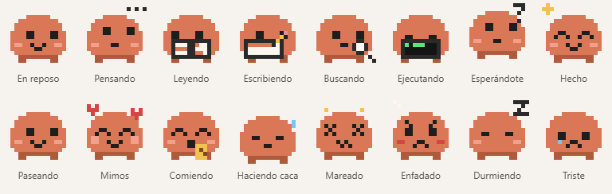
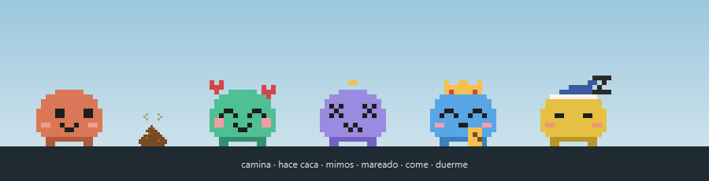

# Claude Buddy

**English** · [Español](README.es.md)

**A desktop pet that brings together all your local Claude Code sessions and lets you resume them from a floating panel.**

Claude Buddy lives in your system tray and as a tiny pixel-art character on your desktop.
Click it to see all your Claude Code conversations (CLI, VS Code extension, and desktop
app) grouped by project: you can search them, read their history, keep chatting in them,
or open them in a terminal. Meanwhile, the buddy mirrors what Claude is doing… and, if you
let it, it has a life of its own too.

<p align="center">
  
  &nbsp;
  
</p>

<p align="center">
  
</p>

> **Unofficial** community project, not affiliated with Anthropic. “Claude” and “Claude Code”
> are trademarks of Anthropic. The character is an original design created for this project.

> The user interface is currently in **Spanish**. UI labels are quoted below in Spanish with
> their English meaning.

## Features

- **All your sessions in one place**: reads `~/.claude/projects` and displays the title (your first message),
  project, last activity, message count, and source (CLI, VS Code, Desktop).
- **Search** by title, project, path, or ID, case- and accent-insensitively.
- **Formatted history** (Markdown, tables, code), tools used, and errors; automatically
  updates if the session is still active elsewhere.
- **Chat** to continue any session with [`claude-agent-sdk`](https://pypi.org/project/claude-agent-sdk/):
  streaming responses, the same project directory, and permission prompts (*Permitir* / *Denegar*: Allow / Deny)
  just like in the terminal.
- **Open in terminal**: runs `claude --resume <id>` in the project folder
  (Windows Terminal / PowerShell, Terminal.app, gnome-terminal, konsole, xterm…).
- **A buddy that reacts**: thinks, reads, searches, runs commands, writes, asks you for permission,
  celebrates when done, and falls asleep when idle. 6 colors and 5 accessories.
- **Pet mode** (*Modo mascota*, optional): walks along the taskbar, falls with gravity if you drop it,
  chases the mouse, eats, poops, sleeps, loves being petted, and gets angry if you shake it.
- **100% local**: no custom servers, no telemetry, no stored credentials (uses the session
  Claude Code already has).

## Pet Mode

<p align="center">
  
</p>

Enable it by right-clicking the buddy → **Modo mascota**. Inspired by classics like eSheep,
Shimeji, oneko, and Desktop Goose.

| What you do | What happens |
|---|---|
| Nothing | Strolls along the taskbar, looks around, yawns, and occasionally chases the mouse |
| Drag and drop it in mid-air | Falls with gravity; if the fall is hard, “¡Ay!” (Ouch!) |
| Move the mouse back and forth over it | **Petting**: hearts appear and its happiness goes up |
| Shake it while dragging | Gets **dizzy** and then **angry** for a while (refuses petting) |
| Menu → *Mascota → Dar de comer* (Pet → Feed) | Eats a cookie… and after a while **poops** |
| Click on a poop | Cleans it up (it likes having a clean space) |
| Leave it alone for a long time | Gets tired and **sleeps**; if hungry or bored, gets **sad** |

It has **hunger, happiness, and energy** levels, which are saved on exit (and keep changing, up to a limit,
while the app is closed). Hover over it to see them. If you chat with Claude from the panel,
the pet stays still and shows what Claude is doing.

## Installation

### Windows (installer)

Download `ClaudeBuddy-Setup-<version>.exe` from [Releases](../../releases) and run it. No
administrator privileges required: it installs for your user, with a Start menu shortcut and an option to
**start with Windows**. Uninstall it from *Settings → Apps*.

### From source (Windows, Linux, macOS)

Requirements: Python 3.12+ and [uv](https://docs.astral.sh/uv/).

```bash
git clone <repository-url>
cd claude-buddy
uv sync
uv run claude-buddy              # tray app
uv run python -m claude_buddy    # same, with a console to see errors
uv run claude-buddy-list         # list sessions in the terminal
```

### Requirements for chatting

[Claude Code](https://code.claude.com/docs) installed and signed in
(`claude` command). Without it, Claude Buddy can list sessions and show their history, but cannot
continue conversations.

## Usage

- **Click** the buddy or the tray icon: opens or closes the panel. **Right-click**: menu
  (color, accessory, size, hide pet, pet mode, quit).
- **Double-click** (or `Enter`) on a session: opens history. `Esc` or `←` goes back to the list.
- **Chat**: type at the bottom; `Enter` sends, `Shift+Enter` adds a newline, `■` stops.
  The bottom selector chooses the permission mode: *Preguntar* (Ask), *Aceptar ediciones* (Accept edits), or *Solo planificar* (Plan only).
- **Open in terminal**: `>_` button in the history view or right-click on a session.
- Shortcuts: `Ctrl+F` search, `↓` jump to list, `F5` refresh.
- 📌 pins the panel open; drag it by the header and resize from the corner.

> **One session, one place at a time.** If the same session is open in VS Code or a terminal,
> do not write from the panel as well: responses will get mixed up. The panel warns you if the session
> has had recent activity.

### Diagnostics

`ClaudeBuddy.exe --diagnose` (or `uv run python -m claude_buddy --diagnose`) checks Claude Code,
sessions, and the SDK connection **without sending any messages**. Logs are stored at
`%LOCALAPPDATA%\ClaudeBuddy\ClaudeBuddy\logs\buddy.log` (Windows) or in your system's
application data folder.

## Privacy

- The app **only reads** `~/.claude` (or `CLAUDE_CONFIG_DIR`). When you chat, Claude Code itself
  appends messages to the session, just like in the terminal.
- There are no custom servers or telemetry. The only network connections are those made by Claude
  Code to talk to Claude.
- No credentials are stored. Preferences (color, position, pet needs) are saved
  using `QSettings` under your user profile.

## How It Works

```
src/claude_buddy/
├── parser.py, scanner.py   tolerant reading of ~/.claude/projects/*/*.jsonl (cached)
├── transcript.py           history: main conversation chain, tools, errors
├── chat.py                 claude-agent-sdk in an asyncio thread (resume, streaming, permissions)
├── terminal.py             `claude --resume` in each system's terminal
├── pet.py                  pet mode logic (needs, physics, gestures), without Qt
├── app.py                  tray, desktop pet, panel, and buddy states
└── ui/                     PySide6: panel, list, history, chat, sprites, icons
```

The session file format is not public; it is documented from real sessions in
[docs/jsonl-format.md](docs/jsonl-format.md). Sprites are 16×16 matrices in
[`ui/sprites.py`](src/claude_buddy/ui/sprites.py): adding a state or accessory is just editing text.

## Development

```bash
uv sync
uv run pytest                      # tests (synthetic data; never read your sessions)
uv run python docs/screenshots.py  # regenerate README images with mock data
```

### Building the Windows installer

Requires [Inno Setup 6](https://jrsoftware.org/isinfo.php) (`winget install JRSoftware.InnoSetup --scope user`).

```powershell
powershell -ExecutionPolicy Bypass -File packaging\build.ps1
```

This runs the tests, generates the icon, packages with PyInstaller, and creates
`dist\ClaudeBuddy-Setup-<version>.exe`. It does not bundle the `claude.exe` (~390 MB) included with
`claude-agent-sdk`: it uses the user's installed Claude Code.

## Known Limitations

- The format of `~/.claude` may change with new versions of Claude Code; the reader ignores
  unrecognized fields and warns about malformed lines.
- If Claude asks a multiple-choice question during chat, the panel only lets you allow or
  deny it, not pick an option.
- The cost shown upon completion is the estimate reported by Claude Code (API equivalent).
- Tested primarily on Windows 11; on Linux without a system tray, the panel opens as a regular window.

## License

[MIT](LICENSE). The character and its sprites are original to this project and are distributed under the
same license. “Claude” and “Claude Code” are trademarks of Anthropic and are not covered by it.
