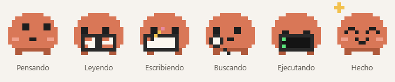
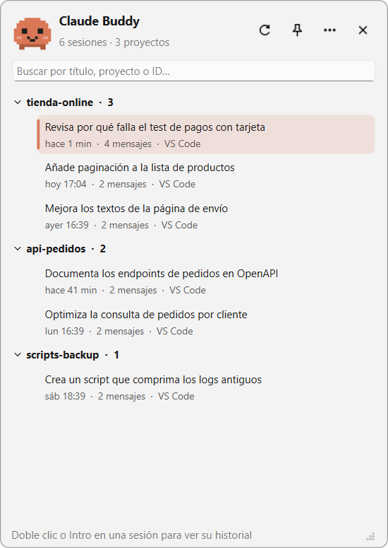
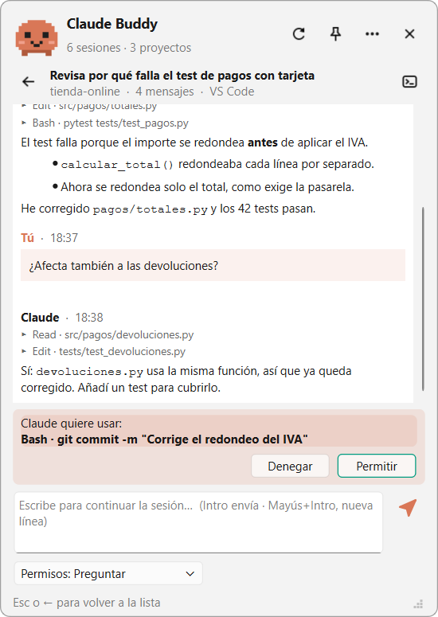

<p align="center"><b>English</b> · <a href="README.es.md">Español</a></p>

<p align="center">
  
</p>

<h1 align="center">Claude Buddy</h1>

<p align="center">
  <b>A desktop pet for all your Claude Code sessions.</b><br>
  Search them, read their history, keep chatting with them, or open them in the terminal,<br>
  while a tiny pixel-art companion tells you what Claude is doing.
</p>

<p align="center">
  
  
  
  
  
  
</p>

<p align="center">
  <a href="../../releases"><b>Download</b></a> ·
  <a href="#installation">Installation</a> ·
  <a href="#pet-mode">Pet mode</a> ·
  <a href="#usage">Usage</a> ·
  <a href="#privacy">Privacy</a> ·
  <a href="docs/jsonl-format.md">Session format</a>
</p>

<p align="center">
  
</p>

<table>
  <tr>
    <td width="50%"></td>
    <td width="50%"></td>
  </tr>
  <tr>
    <td align="center"><b>All your sessions</b><br><sub>CLI, VS Code, and Desktop, grouped by project and searchable</sub></td>
    <td align="center"><b>History and chat</b><br><sub>Continue any conversation with streaming responses and permissions</sub></td>
  </tr>
</table>

> **Unofficial** community project, not affiliated with Anthropic. “Claude” and “Claude Code”
> are trademarks of Anthropic. The character is an original design of this project.
>
> The user interface is currently in **Spanish**; UI labels are quoted in Spanish with their
> English meaning.

## Features

<table>
  <tr>
    <td width="33%" valign="top">🗂️ <b>Sessions in one place</b><br>Reads <code>~/.claude/projects</code>: title, project, last activity, messages, and source.</td>
    <td width="33%" valign="top">🔎 <b>Search</b><br>By title, project, path, or ID, case- and accent-insensitive.</td>
    <td width="33%" valign="top">📜 <b>History</b><br>Markdown, tables, code, tools used, and errors; updates live.</td>
  </tr>
  <tr>
    <td valign="top">💬 <b>Chat</b><br>Continue the session with <code>claude-agent-sdk</code>: streaming, same project, and permission prompts.</td>
    <td valign="top">🖥️ <b>Open in terminal</b><br><code>claude --resume &lt;id&gt;</code> in the project folder, on Windows, macOS, and Linux.</td>
    <td valign="top">🐾 <b>Pet mode</b><br>Walks around, falls, eats, poops, sleeps, loves pets, and hates being shaken.</td>
  </tr>
  <tr>
    <td valign="top">🎨 <b>Make it yours</b><br>6 colors, 5 accessories, and 3 sizes. Lives in the system tray and on your desktop.</td>
    <td valign="top">🔒 <b>100% local</b><br>No custom servers or telemetry. Uses your existing Claude Code session.</td>
    <td valign="top">📦 <b>Installer</b><br>For Windows, no admin privileges required, with an option to start with the system.</td>
  </tr>
</table>

## Pet mode

<p align="center">
  
</p>

Enable it by right-clicking the buddy → **Modo mascota** (Pet mode). Inspired by classics like eSheep,
Shimeji, oneko, or Desktop Goose.

| What you do | What happens |
|---|---|
| Nothing | Walks along the taskbar, looks around, yawns, and sometimes chases the mouse |
| Drop it in mid-air | Falls with gravity; if the fall is hard, “¡Ay!” (Ouch!) |
| Move the mouse back and forth over it | **Petting**: hearts appear and its happiness goes up |
| Shake it while dragging | Gets **dizzy** and then **angry** for a while (doesn't want pets) |
| Menu → *Mascota → Dar de comer* (Pet → Feed) | Eats a cookie… and after a while **poops** |
| Click on a poop | You clean it up (it likes keeping its space clean) |
| Leave it alone for a long time | Gets tired and **sleeps**; if it gets hungry or bored, it gets **sad** |

It has **hunger, happiness, and energy**, which are saved when you close the app. Hover over it to
see them. If you chat with Claude from the panel, the pet stays still and shows what Claude is doing.

## Installation

**Windows:** download `ClaudeBuddy-Setup-<version>.exe` from [Releases](../../releases) and run it.
No admin privileges required; it installs for your user, with a Start menu shortcut and an
option to **start with Windows**. Uninstall it from *Settings → Apps*.

**From source** (Windows, Linux, macOS), with Python 3.12+ and [uv](https://docs.astral.sh/uv/):

```bash
git clone <repository-url>
cd claude-buddy
uv sync
uv run claude-buddy              # tray app
uv run python -m claude_buddy    # same, with a console to see errors
uv run claude-buddy-list         # list sessions in the terminal
```

> [!NOTE]
> To **chat**, you need [Claude Code](https://code.claude.com/docs) installed and logged in
> (`claude` command). Without it, Claude Buddy still lists sessions and shows their history.

## Usage

| Action | How |
|---|---|
| Open / close the panel | Click the buddy or the tray icon |
| Menu (color, accessory, size, pet mode…) | Right-click the buddy or the tray icon |
| View a session's history | Double-click or `Enter`; `Esc` or `←` goes back to the list |
| Chat | Type below; `Enter` sends, `Shift+Enter` inserts a new line, `■` stops |
| Permission mode | *Preguntar* (Ask), *Aceptar ediciones* (Accept edits), or *Solo planificar* (Plan only) |
| Open in terminal | The `>_` button in the history view or right-click a session |
| Shortcuts | `Ctrl+F` search · `↓` jump to list · `F5` refresh · 📌 pin the panel |

> [!WARNING]
> **One session, one place at a time.** If the same session is open in VS Code or a terminal,
> don't also write to it from the panel: replies would get mixed up. The panel warns you if the
> session has had recent activity.

**Diagnostics:** `ClaudeBuddy.exe --diagnose` checks Claude Code, your sessions, and the SDK connection
**without sending any messages**. The log is stored at `%LOCALAPPDATA%\ClaudeBuddy\ClaudeBuddy\logs\buddy.log`.

## Privacy

- The app **only reads** `~/.claude` (or `CLAUDE_CONFIG_DIR`). When you chat, Claude Code itself
  appends the messages to the session, just like in the terminal.
- No custom servers or telemetry: the only network connections are the ones Claude Code makes.
- Stores no credentials. Preferences (color, position, pet needs) are saved
  with `QSettings` under your user account.

## How it works

```
src/claude_buddy/
├── parser.py, scanner.py   lenient reader for ~/.claude/projects/*/*.jsonl (cached)
├── transcript.py           history: main conversation thread, tools, errors
├── chat.py                 claude-agent-sdk in a thread with asyncio (resume, streaming, permissions)
├── terminal.py             `claude --resume` in each OS's default terminal
├── pet.py                  pet mode logic (needs, physics, gestures), no Qt
├── app.py                  tray, desktop pet, panel, and buddy states
└── ui/                     PySide6: panel, list, history, chat, sprites, icons
```

The session file format is not public; it is documented from real sessions in
[docs/jsonl-format.md](docs/jsonl-format.md). Sprites are 16×16 matrices in
[`ui/sprites.py`](src/claude_buddy/ui/sprites.py): adding a state or accessory is just editing text.

## Development

```bash
uv sync
uv run pytest                      # tests (synthetic data; never reads your sessions)
uv run python docs/screenshots.py  # regenerates README images and GIFs with mock data
powershell -ExecutionPolicy Bypass -File packaging\build.ps1   # Windows installer
```

The installer requires [Inno Setup 6](https://jrsoftware.org/isinfo.php)
(`winget install JRSoftware.InnoSetup --scope user`). It does not bundle the `claude.exe` (~390 MB) included with
`claude-agent-sdk`: it uses the user's installed Claude Code.

## Known limitations

- The `~/.claude` format may change with new Claude Code releases; the reader ignores unknown
  fields and warns about malformed lines.
- If Claude asks a multiple-choice question during chat, the panel only lets you allow or
  deny it, not pick an option.
- The cost shown at the end is the estimate reported by Claude Code (API equivalent).
- Tested mainly on Windows 11; on Linux without a system tray, the panel opens as a regular window.

## License

[MIT](LICENSE). The character and its sprites are original to this project and are distributed under the
same license. “Claude” and “Claude Code” are trademarks of Anthropic and are not covered by it.

<p align="center"></p>
